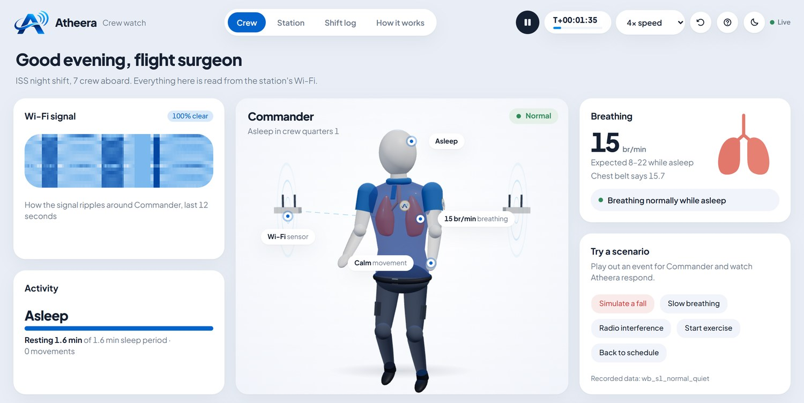
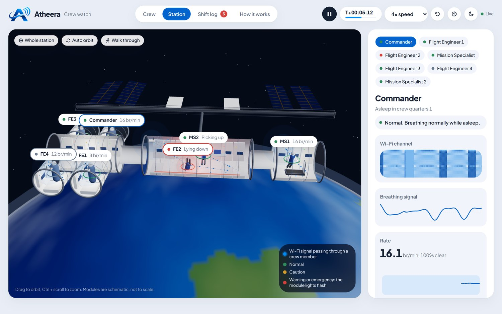

# Atheera: contactless crew health monitoring from Wi-Fi

**A health and safety watch for astronauts that needs no camera, no wearable and no new sensor.**
Atheera reads how a person's body disturbs the Wi-Fi signal already filling a room (channel state information, CSI)
and turns it into **breathing rate**, **activity and falls**, **rest during the sleep period** and **unusual-movement**
alerts, shown on a live crew dashboard with a 3D station view. Built for the NASA Space Apps 2026 challenge
*Create Health Monitoring Software for Astronauts on Space Missions*.

## Screenshots


*Crew page: seven crew, live breathing and activity.*


*Station view at the scripted fall: the lab turns red and the alert is logged.*

## Results

Every figure comes from held-out recordings of public datasets, with whole recordings kept apart between training and testing.

| Measure | Result | Test |
|---|---|---|
| **Breathing rate** | **0.40 breaths/min** mean error (median 0.10), **96.2%** within ±2. A classic method scores 0.84 on the same windows | 1,403 windows, 465 recordings, 5 people, 2 rooms, 9 postures |
| **Activity** | **96.0%** accuracy. The benchmark's own recipe scores 91.9% on the same strict split | 995 windows, 112 held-out recordings |
| **Falls** | **16 of 16** fall recordings caught, 1 false alarm in 96 recordings (95% intervals: 79–100% caught, 0.03–5.7% false alarms) | held-out recordings |
| **Rest in the sleep period** | **97.9%** of time scored as rest, 0.0% wrongly scored awake | WiRe-Breath recordings played as sleep periods |
| **Known-answer test** | 6.5–34 breaths/min recovered within 0.2; pure noise gets confidence 0 | synthetic signals |
| **Engineering** | **38** automated tests | `pytest` |

The published 98.3% accuracy for the standard activity benchmark is inflated: 499 of its 500 test windows come from
recordings that also supply training windows. Atheera is evaluated on the stricter split. Details and every limit are in
[docs/LIMITATIONS.md](docs/LIMITATIONS.md).

## How it works

```
Wi-Fi CSI ─► clean-up ─► four readers ─► fusion & alerts ─► replay ─► dashboard
             filter,     breathing,      context-aware       FastAPI   Next.js
             resample    activity+falls, limits, debounce,             + 3D station
                         movement, rest  latching, evidence
```

- **Breathing:** band-pass 6–36 breaths/min, the 30 clearest channels fused into one spectrum, Viterbi tracking, and a calibrated confidence. It reports "lost" instead of guessing, and has no rate prior, so abnormal breathing is not hidden.
- **Activity and falls:** an ensemble of 4 ResNet-18 networks (11.2 M parameters each) trained with noise, gain, dead-subcarrier and packet-loss augmentation.
- **Unusual movement:** a motion index compared with the person's own 120-second baseline.
- **Rest:** steady breathing with no body movement during the scheduled sleep period (the idea behind wrist actigraphy, from Wi-Fi). Time the system cannot judge is reported separately, never counted as rest.
- **Alerts:** advisory, caution, warning and emergency levels that follow the ISS caution-and-warning classes. Alerts are rule-based, latch until acknowledged and carry the evidence behind them.

How Atheera maps to the challenge and to NASA's hazards: [docs/CHALLENGE.md](docs/CHALLENGE.md).

## Run the demo

```bash
pip install -e .            # Python 3.10+
cd dashboard && npm install && npm run build && cd ..
uvicorn atheer.api.main:app --port 8010
# open http://127.0.0.1:8010  (the ten-minute demo shift starts by itself; a guided tour opens on the first visit)
```

Development with hot reload: run the uvicorn command above, then `cd dashboard && npm run dev` and open http://localhost:3000 (Next.js proxies `/api` to the backend on :8010; the telemetry WebSocket connects to :8010 directly).

## Run with Docker (local)

One command builds everything (the Next.js dashboard, then a slim Python runtime) and serves the whole app on one port. No dataset, no model weights and no GPU are needed — the backend replays the recordings in `results/tracks`.

```bash
docker compose up --build
# open http://localhost:8010  (the demo shift starts by itself)
```

To stop: `docker compose down`. To see the logs: `docker compose logs -f`.

## Deploy with Docker (Ubuntu server)

What you need: a server with Docker + the Compose plugin (`sudo apt-get install docker.io docker-compose-v2` on Ubuntu 24.04), and the code (clone this repo, or rsync your working copy if it is private).

1. **Get the code on the server.** For a private repo, add a read-only [deploy key](https://docs.github.com/en/authentication/connecting-to-github-with-ssh/managing-deploy-keys) so the server can `git pull`; otherwise rsync from your machine.

2. **Point a domain at the server** (A record → your server IP). For HTTPS the app ships with [Caddy](https://caddyserver.com), which issues and renews Let's Encrypt certificates automatically. Edit `Caddyfile` and replace the example domain with yours:

   ```text
   atheera.yousry.dev {
   	reverse_proxy atheera:8010
   }
   ```

3. **Open the firewall / cloud security group** for ports 80 and 443 (80 is required for the Let's Encrypt challenge, 443 serves the app).

4. **Start it:**

   ```bash
   docker compose -f docker-compose.yml -f docker-compose.override.yml up -d --build
   # open https://your-domain.example
   ```

   The override file (`docker-compose.override.yml`) publishes only Caddy on 80/443 and keeps the app on the internal network. Without HTTPS or a domain, skip the override and the Caddy service: `docker compose up -d --build` serves plain HTTP on 8010 (`ports: "8010:8010"` in `docker-compose.yml`).

5. **Update it later:**

   ```bash
   cd ~/Atheer
   git pull
   docker compose -f docker-compose.yml -f docker-compose.override.yml up -d --build
   ```

Housekeeping: the container restarts on crash and on server reboot (`restart: unless-stopped`), has a `/api/state` healthcheck, and runs as an unprivileged user with all capabilities dropped. Rebuilding the replay tracks or retraining models is done outside the image (see "Rebuild data and results" below), since the demo only replays the committed `results/tracks`.

## What this is, and what comes next

Atheera is a research prototype. The demo is a replay of real recorded Wi-Fi data through the complete pipeline, the same way a live stream would flow: no live hardware and no microgravity data were used.

- **History:** the project was developed locally and uploaded to this repository as a snapshot, so the commit history is short and does not show when each part was written.
- **Data:** the recordings were made on Earth (WiRe-Breath for breathing and rest, UT-HAR for activity and falls). No CSI data from orbit exists yet.
- **Next:** a live ESP32 or Intel 5300 stream, recordings in a metal-walled mock-up, more people, and review of alert thresholds with flight surgeons.
- **Scope:** breathing, activity, rest and falls. Heart rate, blood pressure, blood sugar, temperature and mood stay with the medical kit's dedicated instruments; Atheera complements them and is not a medical device.

## Rebuild data and results

```bash
python scripts/build_tracks.py --synthetic                         # placeholders (no downloads)
python scripts/train_breath_confidence.py --root data/raw/wirebreath # breathing eval + confidence calibration
python scripts/build_tracks.py --wirebreath data/raw/wirebreath    # real breathing tracks (uses the model)
python scripts/build_tracks.py --uthar data/raw/sensefi            # real activity / fall tracks
python scripts/eval_respiration.py                                 # classic baseline -> results/eval_respiration_classic.json
python scripts/exp_activity_robust.py groups && python scripts/exp_activity_robust.py p1train --variant robust  # robust activity model
python scripts/eval_activity.py                                    # held-out recordings -> results/eval_activity.json, eval_anomaly.json
pytest -q
```

Data sources: WiRe-Breath GitHub release v1.0.0 (`data/raw/wirebreath`), SenseFi Google Drive (`UT_HAR.zip` into `data/raw/sensefi`, weights into `models/sensefi/UT-HAR`). See [THIRD_PARTY.md](THIRD_PARTY.md).

## Layout

| Path | What it does |
|---|---|
| `atheer/ingest/` | Dataset loaders (WiRe-Breath port of the authors' MATLAB loader) |
| `atheer/modules/respiration.py` | Amplitude + cross-subcarrier-ratio channels → band-pass → summed spectra of the best 30 channels → Viterbi tracking → rate + calibrated confidence (classic PCA peak kept as baseline) |
| `atheer/modules/activity.py` | SenseFi ResNet-18 ensemble trained with robustness augmentation on UT-HAR (published weights kept for reproduction); dead-subcarrier repair, per-window normalisation, calibrated probabilities |
| `atheer/modules/anomaly.py` | Motion index vs personal baseline, fall probability |
| `atheer/modules/rest.py` | Rest tracker for the scheduled sleep period |
| `atheer/fusion/engine.py` | Crew context, context-aware limits, confidence gating, debounced caution-and-warning alerts with evidence |
| `atheer/fusion/brief.py` | Optional crew brief endpoint (language model with an offline template fallback); the dashboard does not use it and it never decides an alert |
| `atheer/replay/` + `scenarios/` | Scenario timeline that streams dataset tracks through the pipeline |
| `atheer/api/main.py` | REST + WebSocket backend |
| `dashboard/` | Next.js 16 + React 19, Tailwind 4, shadcn/Radix, TanStack Query, Recharts and React Three Fiber; exported as static files to `dashboard/dist`. Pages: Crew, Station (3D with a walk-through mode), Shift log, How it works, plus a guided tour |
